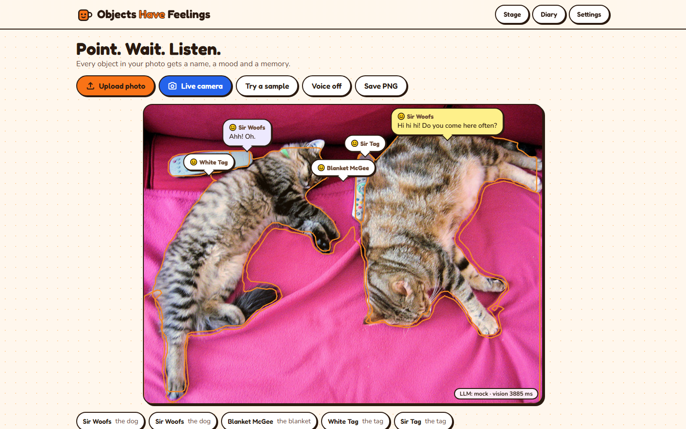
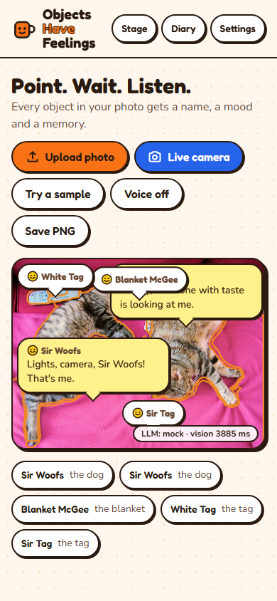
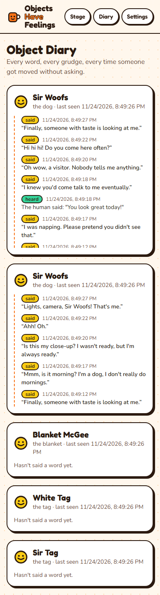
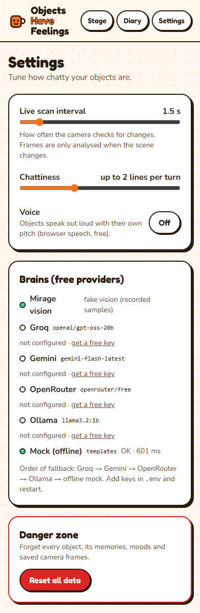

# Objects Have Feelings

[](https://github.com/sirajahmedshaikh454-dev/anima-objects-have-feelings/actions/workflows/ci.yml)

Point your camera (or upload a photo) at any scene. Every object gets a name, three personality traits, a mood and a voice, and starts talking in speech bubbles right on top of where it is. Move the mug and the mug complains. Ignore it for a day and it holds a grudge. **Everything is free**: local vision, free-tier LLMs with an offline fallback, and a local SQLite file.



| Mobile | Diary | Settings |
|---|---|---|
|  |  |  |

## How it works

```mermaid
flowchart LR
  Cam[Camera / upload] -->|frame only if scene changed<br/>one request at a time| Scan[/api/scan/]
  Scan --> Mirage[Mirage VLM<br/>local Python service]
  Mirage -->|objects, boxes, masks, OCR, relations| Norm[normalize]
  Norm --> Match[object matcher]
  Match --> Change[change detector<br/>appeared / moved / vanished / near]
  Change --> DB[(SQLite<br/>data/anima.db)]
  Change --> Talk[/api/talk SSE/]
  DB -->|souls, last 5 memories, relationships| Talk
  Talk --> Chain{{Groq → Gemini → OpenRouter → Ollama → mock}}
  Chain -->|tokens, streamed| UI[Three.js stage<br/>GSAP bubbles]
```



- **Images never leave your PC.** Mirage runs locally; cloud LLMs only get text (labels, OCR text, memories).
- **Vision:** [Cactus Mirage](https://pypi.org/project/cactus-compute/) (51 M params, ~22 MB, Apache-2.0) in a FastAPI service, loaded once.
- **Personality:** one adapter over free providers. Each is used only if its key is in `.env`; on 429, timeout (8 s) or error it retries once, then falls to the next. The offline mock engine (80+ lines) always works.
- **Memory:** better-sqlite3 + Drizzle, WAL mode. Moods drop when an object is ignored and rise when it's seen or talked to.

## Free keys (all optional)

| Provider | Get a free key | `.env` variable |
|---|---|---|
| Groq (fastest) | https://console.groq.com/keys | `GROQ_API_KEY` |
| Google Gemini | https://aistudio.google.com/apikey | `GEMINI_API_KEY` |
| OpenRouter (`:free` models) | https://openrouter.ai/keys | `OPENROUTER_API_KEY` |
| Ollama (local) | https://ollama.com/download, then `ollama pull llama3.2:1b` | `OLLAMA_URL=http://127.0.0.1:11434` |

With no keys at all, the app still runs on the mock engine. Model names can be overridden in `.env` (defaults: `lib/personality/config.ts`).

## Setup

Needs **Node.js 22+** and **Python 3.10+** (3.13 tested).

**Windows (PowerShell):**

```powershell
git clone https://github.com/sirajahmedshaikh454-dev/anima-objects-have-feelings.git
cd anima-objects-have-feelings
copy .env.example .env
npm run setup
npm run dev
```

**macOS / Linux:**

```bash
git clone https://github.com/sirajahmedshaikh454-dev/anima-objects-have-feelings.git
cd anima-objects-have-feelings
cp .env.example .env
npm run setup
npm run dev
```

`npm run setup` installs npm packages, creates the Python venv in `services/mirage/.venv`, installs Mirage and creates the database. `npm run dev` starts **both** Next.js (http://localhost:3000) and the Mirage service (port 8765). The first start downloads the Mirage weights (~22 MB) once.

Open http://localhost:3000, click **Try a sample**, **Upload photo** or **Live camera**.

### On your phone (same Wi-Fi)

Browsers only allow the camera on `https://` or `localhost`. Run:

```bash
npm run dev:https
```

and open `https://<your-PC-LAN-IP>:3000` on the phone (accept the self-signed certificate warning). The server listens on `0.0.0.0`. Find your IP with `ipconfig` (Windows) or `ipconfig getifaddr en0` (macOS).

## Scripts

| Command | What it does |
|---|---|
| `npm run dev` | Next.js + Mirage service together |
| `npm run dev:https` | Same, with a dev HTTPS certificate (phone camera) |
| `npm run check:providers` | One tiny call per configured free LLM → `docs/PROVIDER_CHECK.md` |
| `npm run db:migrate` / `db:seed` / `db:reset` | Database file `data/anima.db` |
| `npm test` | Vitest unit tests |
| `npm run test:py` | pytest for the Mirage service |
| `npm run test:e2e` | Playwright (fake webcam, recorded Mirage output, mock LLM) |
| `npm run verify` | lint + typecheck + unit + pytest + build (the quality gate) |

## Project layout

```
app/                 pages + API routes (scan, talk SSE, reply, objects, settings)
components/three/    Three.js stage (mask glow, sparkles) + GSAP bubbles
components/ui/       Stage, Soul Card, mood graph
lib/vision/          Mirage types (from real samples), normalizer, client
lib/personality/     souls, provider configs, fallback engine, mock engine
lib/prompts/         all LLM prompts
lib/db/              Drizzle schema, queries, settings
lib/realtime/        matcher, change detector, pipeline, frame gate, layout, SSE
services/mirage/     FastAPI service + pytest
tests/  e2e/         Vitest + Playwright
docs/                decisions, mission log, blockers, Mirage samples, screenshots
```

## Troubleshooting

| Problem | Fix |
|---|---|
| "The vision service is not running" | Start with `npm run dev` (or `npm run dev:mirage` in a second terminal). Check http://127.0.0.1:8765/health. |
| "Mirage venv missing" | `npm run setup` |
| Windows: `DLL load failed … filename or extension is too long` | Move the project to a shorter path (e.g. `C:\code\anima`). Windows can't load some DLLs from very deep folders. |
| Camera doesn't open on the phone | Use `npm run dev:https` and the `https://` address. |
| "Your objects are asleep" | Mirage found nothing: try more light, get closer, or use a busier scene. |
| Replies are the same few jokes | No free LLM key is set, so the offline mock engine is talking. Add one (see above) and restart. |
| Scans take ~4 s | That's Mirage on a laptop CPU (see `docs/BLOCKERS.md`). |

## Docs

[Decisions](docs/DECISIONS.md) · [Mission log](docs/MISSION_LOG.md) · [Blockers](docs/BLOCKERS.md) · [Demo script](docs/DEMO.md) · [Final report](docs/FINAL_REPORT.md)

Sample photos: COCO 2017 validation set (Creative Commons Flickr images).
